# swipe-styles

**Instagram and LinkedIn carousels in 12 designed styles, from one sentence.**

An open-source plugin for [Claude Code](https://code.claude.com). You describe the post; it writes the
slides, renders them as images and a PDF, and checks that every line fits.

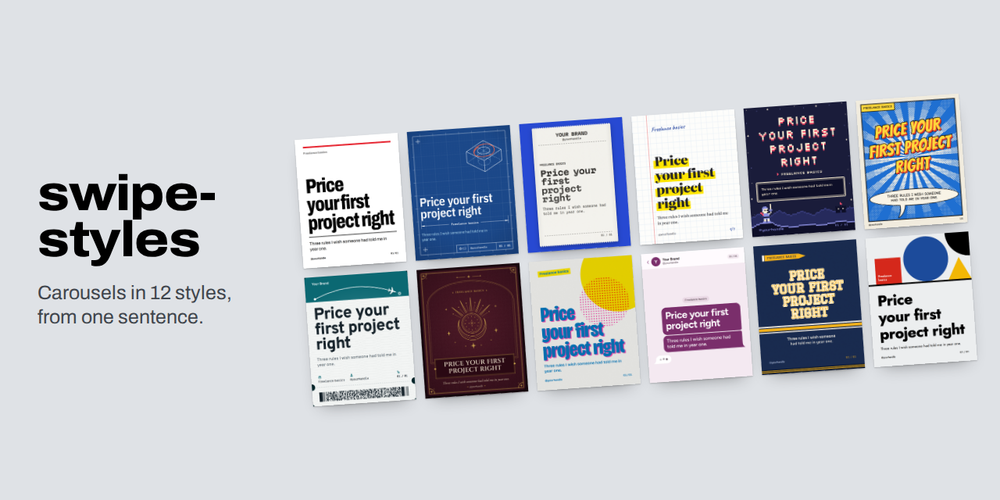

**[See every style in the gallery](https://shango-tek.github.io/swipe-styles/)**

## Install

In Claude Code:

```
/plugin marketplace add shango-tek/swipe-styles
/plugin install swipe-styles@swipe-styles
```

You need Node.js 20 or newer. The first carousel runs a one-time setup: it installs Playwright (about
20 MB) into `~/.cache/swipe-styles` and uses the Chrome on your computer. Without Chrome, it downloads a
headless Chromium (about 100 MB).

## Use

Say what you want, in one sentence:

> Make an Instagram carousel about my sourdough mistakes in the Notebook style.

> Turn the questions couples ask me into a Chat Thread carousel.

> Erstell ein LinkedIn-Karussell: 5 Fehler bei der ersten Rechnung. Mein Handle ist @klara.schreibt, meine Farbe #2F5D50.

Claude picks an angle, writes the slides in your language, renders them, fixes any text that does not
fit and looks at the result. You get a folder with:

| file | for |
|---|---|
| `slide-01.png` and onwards | Instagram, 1080 × 1350 (or 1080 × 1080 if you ask for square) |
| `carousel.pdf` | a LinkedIn document post |
| `caption.txt` | the caption and hashtags, ready to paste |

Change anything with one more sentence: "switch to Receipt", "make it German", "shorter". Nothing is
posted for you.

## Same post, twelve styles

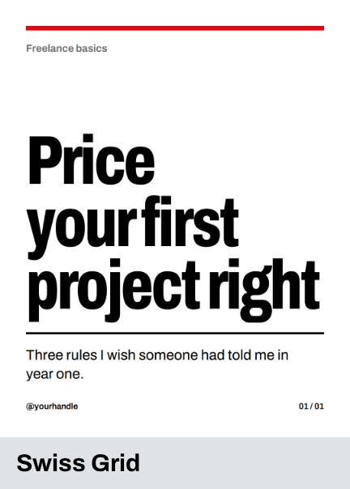

<!-- styles:start -->
| | style | suits |
|---|---|---|
| <a href="https://shango-tek.github.io/swipe-styles/#swiss-grid">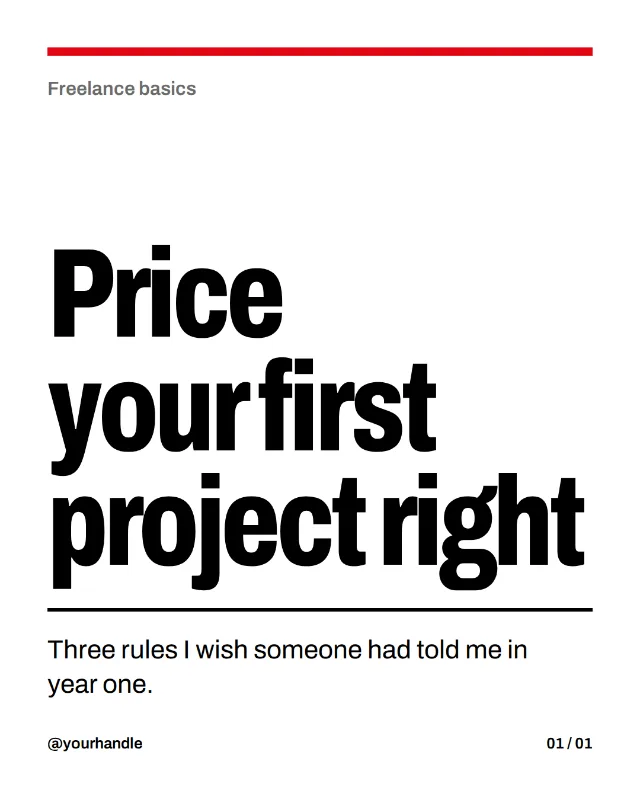</a> | **[Swiss Grid](https://shango-tek.github.io/swipe-styles/#swiss-grid)**<br>Big condensed grotesque on white, a strict grid, black rules, and one red bar that shows how far the reader is. | professional tips, LinkedIn explainers, frameworks, business lessons, data-led posts |
| <a href="https://shango-tek.github.io/swipe-styles/#blueprint">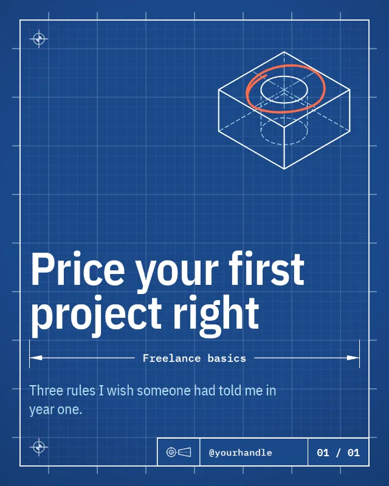</a> | **[Blueprint](https://shango-tek.github.io/swipe-styles/#blueprint)**<br>Every slide is a sheet of a technical drawing: white linework on blueprint blue, a fine construction grid, dimension lines, callout balloons and a title block, with red-orange redline markup. | tech explainers, system design, how things work, engineering, software architecture, product teardowns |
| <a href="https://shango-tek.github.io/swipe-styles/#receipt">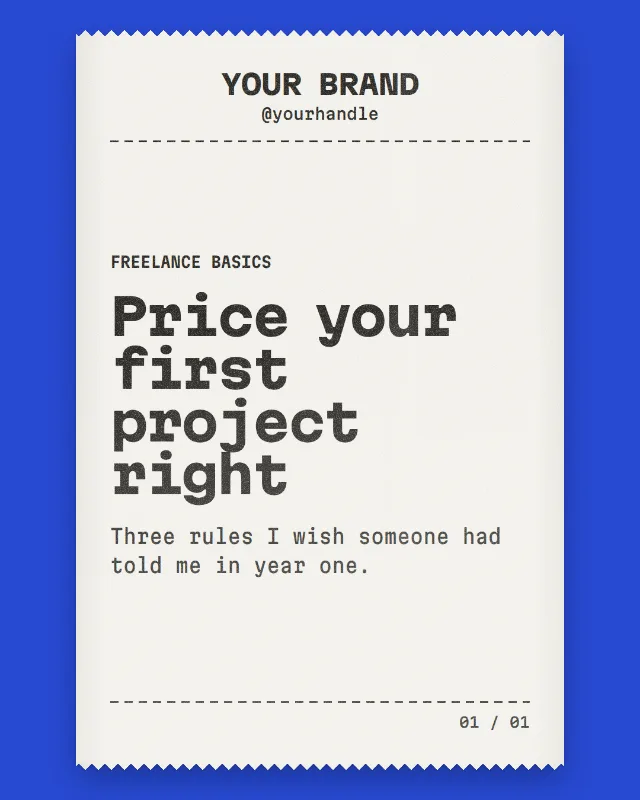</a> | **[Receipt](https://shango-tek.github.io/swipe-styles/#receipt)**<br>A thermal-paper receipt with torn zigzag edges on a solid color: monospace type, dashed rules, dot leaders, a big total and a barcode. | money and budgeting, price breakdowns, shopping and food lists, funny lists, product launches |
| <a href="https://shango-tek.github.io/swipe-styles/#notebook">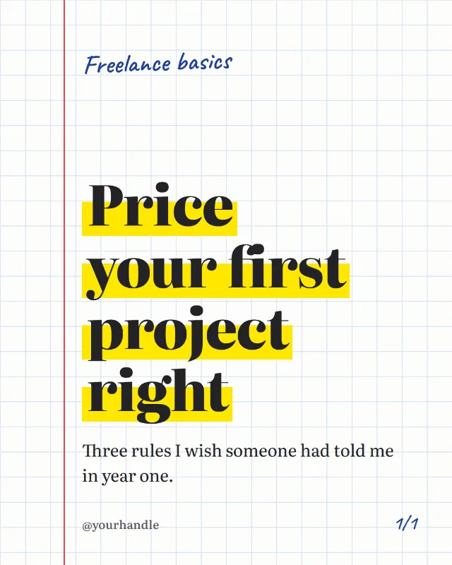</a> | **[Notebook](https://shango-tek.github.io/swipe-styles/#notebook)**<br>A page from a squared school notebook: printed serif text, a highlighter, and notes in blue ink. | study tips, teaching, coaching, how-to guides, book notes, self-improvement |
| <a href="https://shango-tek.github.io/swipe-styles/#pixel-quest">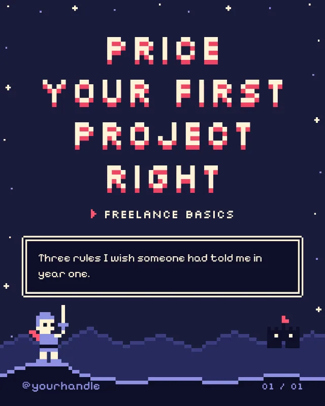</a> | **[Pixel Quest](https://shango-tek.github.io/swipe-styles/#pixel-quest)**<br>Every slide is a screen of an 8-bit role-playing game: a starry night sky, cream dialog windows with a double pixel border, a ▶ cursor and an XP bar. | gaming, tech tips, habits and productivity, learning, fun explainers, level-up challenges |
| <a href="https://shango-tek.github.io/swipe-styles/#comic">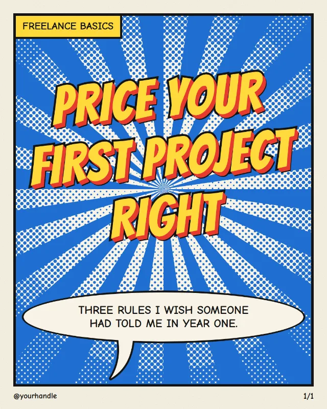</a> | **[Comic](https://shango-tek.github.io/swipe-styles/#comic)**<br>Every slide is a comic book page: thick black ink panels on newsprint, Ben-Day dots, yellow caption boxes, speech balloons and a slanted comic-logo title with a hard 3D shadow. | storytelling, myths vs. facts, before and after, explainers for kids and parents, humor, fun science |
| <a href="https://shango-tek.github.io/swipe-styles/#boarding-pass">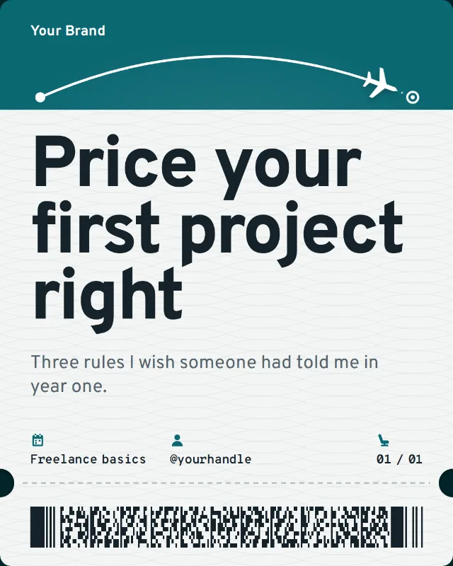</a> | **[Boarding Pass](https://shango-tek.github.io/swipe-styles/#boarding-pass)**<br>Every slide is a portrait boarding pass: a band in the airline color with a flight route whose plane flies one step further with every swipe, a perforated tear line with notches, icons instead of field labels, and a barcode stub. | travel tips, itineraries, events, product launches, roadmaps, career journeys |
| <a href="https://shango-tek.github.io/swipe-styles/#tarot">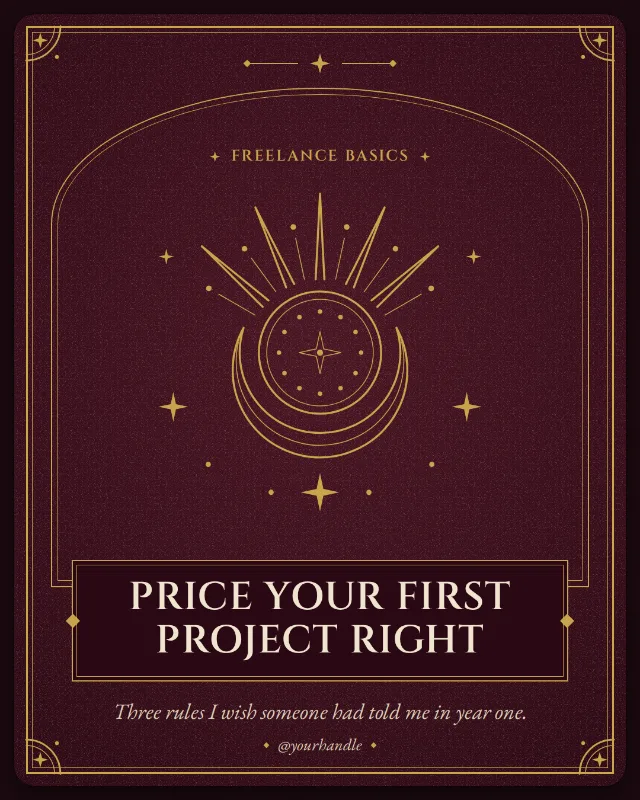</a> | **[Tarot](https://shango-tek.github.io/swipe-styles/#tarot)**<br>Every slide is a tarot card: an oxblood card with a double gold border and corner fans, a Roman numeral at the top, an arched inner frame with a line-art emblem and a name plate at the bottom; the last slide is the patterned card back. | astrology, spirituality, self-reflection and journaling prompts, wellness rituals, books and fantasy, moon and seasonal rituals |
| <a href="https://shango-tek.github.io/swipe-styles/#riso-zine">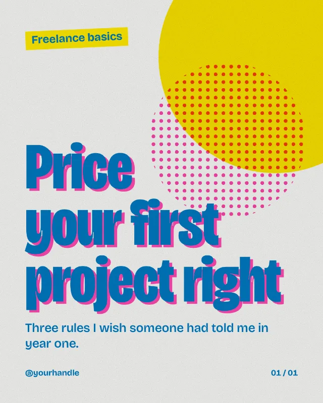</a> | **[Riso Zine](https://shango-tek.github.io/swipe-styles/#riso-zine)**<br>Two-color Risograph print: fluorescent pink and blue ink overprinting on grainy paper, chunky type slightly out of register. | art and design, music, events, creative tips, zines and DIY, Gen-Z creators |
| <a href="https://shango-tek.github.io/swipe-styles/#chat-thread">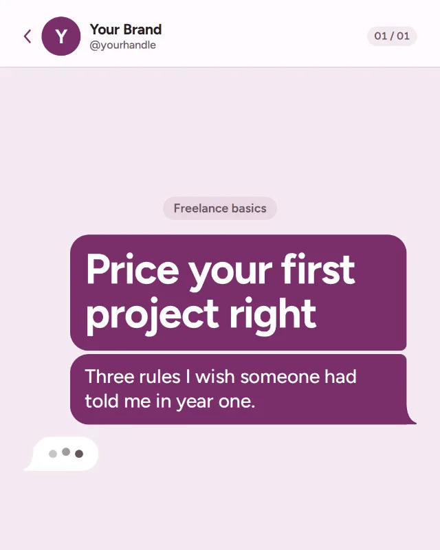</a> | **[Chat Thread](https://shango-tek.github.io/swipe-styles/#chat-thread)**<br>Every slide is a screen of a messaging conversation: the audience asks in white bubbles on the left, the creator answers in accent bubbles on the right, on a pale canvas tinted to match. | coaching, relationships, customer stories, FAQs, marketing tips, conversations and dialogues |
| <a href="https://shango-tek.github.io/swipe-styles/#varsity">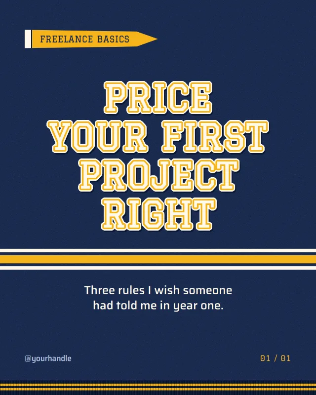</a> | **[Varsity](https://shango-tek.github.io/swipe-styles/#varsity)**<br>A letterman jacket in slides: navy wool, tackle-twill lettering with a gold ring, sleeve stripes, felt pennants, chenille patches and a knit waistband. | fitness, running and sports, coaching, team building, school and college, game-day content |
| <a href="https://shango-tek.github.io/swipe-styles/#bauhaus">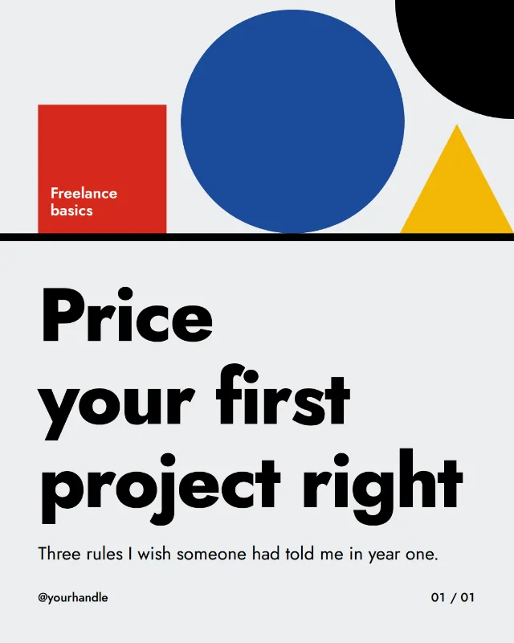</a> | **[Bauhaus](https://shango-tek.github.io/swipe-styles/#bauhaus)**<br>Every slide is a Bauhaus poster: circles, squares, triangles, semicircles and quarter circles in red, yellow, blue and black on cool grey paper, with heavy geometric type standing on, beside or inside the shapes. | design, architecture, art history, education, culture, creative process |
<!-- styles:end -->

## How it works

1. **Content as data.** Claude writes only a small `carousel.json`: a list of slides (cover, text,
   points, quote, number, picture, call to action) and their words.
2. **Style as template.** Each style has layouts for those seven slide types, its own open-source fonts,
   and a writing guide (`STYLE.md`) with word limits.
3. **Render and check.** Playwright renders every slide. The renderer shrinks text that runs long and
   reports anything that still does not fit, with the slide and the field, so Claude can rewrite it.

The design lives in the styles, so every carousel looks finished, and a new style is a folder, not a
prompt.

## Your brand

Add your handle, accent color and logo, and every style uses them:

```json
"brand": { "name": "Northline Studio", "handle": "@northline.studio", "accent": "#0F766E", "logo": "logo.svg" }
```

Each style shows the handle, puts your color where its design has an accent and keeps text readable on
it, and places the logo on the cover and the last slide. Claude reuses the brand of your last carousel.

## Without Claude Code

The renderer is a plain Node script, so you can also write `carousel.json` yourself:

```bash
node plugin/skills/swipe-styles/scripts/setup.mjs
node plugin/skills/swipe-styles/core/render.mjs --styles
node plugin/skills/swipe-styles/core/render.mjs my-post/carousel.json --style receipt
```

The format is described in [SKILL.md](plugin/skills/swipe-styles/SKILL.md).

## Develop

Rendering and tests run in the official Playwright Docker image, so your computer needs only Docker:

```bash
NET=1 tools/docker.sh npm ci
tools/docker.sh npm test
tools/docker.sh npm run demos
tools/docker.sh npm run gallery
```

To add a style, copy a folder in `plugin/skills/swipe-styles/styles/`, change its `style.json`,
`layouts.html`, `style.css`, `STYLE.md` and demo, and run the tests. They check that every slide type
has a layout, that the fonts come with their licenses and that the demo renders without errors.
`npm run gallery` then adds it to the gallery and to the table above.

## License

MIT for the code. The fonts in `plugin/skills/swipe-styles/fonts/` are under the SIL Open Font License,
each with its license file. The demo carousels use made-up brands.
